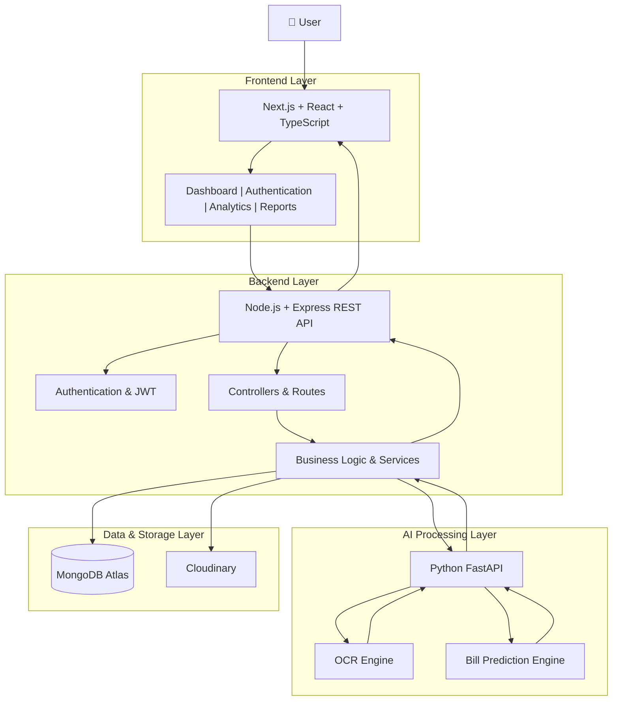
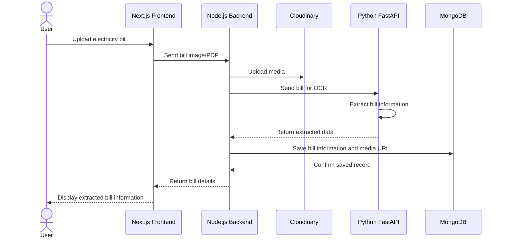
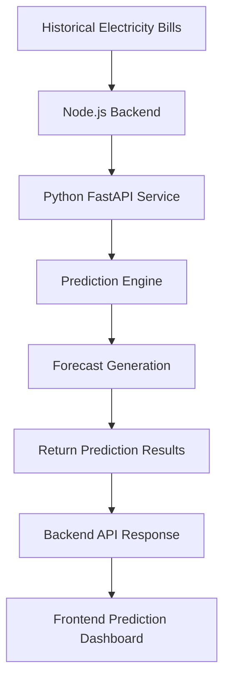

# ⚡ BillSnap – AI-Powered Smart Electricity Bill Analysis & Energy Management

> **Built during a 36-Hour Online Hackathon | Recognized as a Top Performer | Internship Opportunity at Imèrgen(e)**

BillSnap is an AI-powered electricity bill analysis and energy management platform designed to help users understand their electricity consumption, monitor appliance usage, predict future bills, and identify potential energy risks through intelligent analytics.

---

## 🏆 Hackathon Achievement

BillSnap was developed during a **36-hour online hackathon**, where I worked on building an innovative, full-stack AI-powered solution addressing real-world electricity consumption and energy management challenges.

My project development and performance during the hackathon earned me recognition as a **Top Performer**, through which I secured an internship opportunity at **Imèrgen(e)**.

This experience allowed me to demonstrate my technical skills, problem-solving abilities, and practical application of AI and full-stack development under time constraints.

---

## 🌐 Live Application

- **Live Demo:** https://bill-snap-evr5jhpos-sarika-s.vercel.app/
- **GitHub Repository:** https://github.com/Sarikas-07/BillSnap

---

## ✨ Key Features

- **Electricity Bill Analysis:** Upload electricity bills and extract relevant information using OCR.
- **Consumption Analytics:** Visualize electricity consumption through interactive dashboards and charts.
- **Bill Prediction:** Forecast future electricity bills using historical consumption data.
- **Appliance Management:** Track appliances, monitor their power consumption, and organize them by rooms.
- **Energy Risk Analysis:** Identify potential electrical risks using appliance data and rule-based analysis.
- **Savings Recommendations:** Generate practical suggestions to improve energy efficiency.
- **SnapBot Assistant:** An interactive assistant that answers electricity usage and appliance-related queries using user data.
- **Report Generation:** Generate downloadable electricity consumption reports.

---

## 🏗️ System Architecture

BillSnap follows a modular, three-service architecture consisting of a Next.js frontend, Node.js/Express backend, and Python FastAPI AI service.

### High-Level Architecture



### Architecture Components

| Layer | Technology | Responsibility |
|---|---|---|
| Presentation Layer | Next.js, React, TypeScript | User interface, dashboards and visualization |
| Application Layer | Node.js, Express.js | REST APIs, authentication and business logic |
| AI Processing Layer | Python, FastAPI | OCR processing and bill prediction |
| Database Layer | MongoDB Atlas, Mongoose | Persistent storage of application data |
| Media Storage | Cloudinary | Electricity bill images and uploaded media |

### Bill Upload and OCR Workflow

The following workflow explains how BillSnap processes an uploaded electricity bill.



### Bill Prediction Workflow



### Application Architecture Highlights

- **Modular Architecture:** Frontend, backend, and AI processing are maintained as separate services.
- **REST API Communication:** The frontend communicates with the backend through REST APIs.
- **AI Service Integration:** Node.js delegates OCR and prediction operations to Python FastAPI.
- **Persistent Storage:** MongoDB stores user information, appliances, rooms, bills, and SnapBot conversations.
- **Cloud Media Storage:** Cloudinary handles uploaded electricity bill images and media.
- **Separation of Responsibilities:** Authentication, business logic, AI processing, and presentation are handled independently.

---

## 🛠️ Technology Stack

| Component | Technologies |
|---|---|
| Frontend | Next.js, React, TypeScript, Tailwind CSS |
| Backend | Node.js, Express.js |
| Database | MongoDB Atlas, Mongoose |
| AI Service | Python, FastAPI |
| OCR | Python-based OCR processing |
| Authentication | JWT, bcrypt |
| Image Storage | Cloudinary |
| Data Visualization | Recharts |
| Version Control | Git, GitHub |
| Frontend Hosting | Vercel |
| Backend & AI Hosting | Render (planned/separate deployments) |

---

## 📂 Project Structure

```text
BillSnap/
│
├── frontend/
│   ├── public/
│   ├── src/
│   │   ├── app/
│   │   ├── components/
│   │   └── lib/
│   ├── package.json
│   └── next.config.ts
│
├── backend/
│   ├── src/
│   │   ├── config/
│   │   ├── models/
│   │   ├── middleware/
│   │   ├── controllers/
│   │   ├── routes/
│   │   ├── services/
│   │   └── utils/
│   ├── server.js
│   └── package.json
│
├── ai-service/
│   ├── app/
│   │   ├── routers/
│   │   ├── services/
│   │   ├── config.py
│   │   └── main.py
│   └── requirements.txt
│
├── docs/
│   └── mongodb-atlas-setup.md
│
├── README.md
└── requirements.md
```

---

## 🚀 Backend – Node.js & Express

The Node.js/Express backend powers the frontend and provides REST APIs for:

- User authentication and profile management.
- Room and appliance management.
- Electricity bill uploads and manual entries.
- Consumption analytics and savings recommendations.
- Energy risk analysis.
- Bill prediction requests.
- SnapBot conversations and chat history.

### Backend API Overview

All API routes are prefixed with `/api`.

| Resource | Functionality |
|---|---|
| Authentication | Signup, login, logout, user verification |
| Users | Profile management and password updates |
| Rooms | Room creation and management |
| Appliances | Appliance CRUD and consumption tracking |
| Bills | Bill upload, OCR processing and bill management |
| Analytics | Consumption trends, dashboard summaries and savings tips |
| Prediction | Future electricity bill forecasting |
| Risk | Electrical risk analysis |
| SnapBot | Chat interactions and conversation history |

### Backend Design Highlights

- Passwords are hashed using bcrypt.
- JWT-based authentication protects private API endpoints.
- Centralized error handling provides consistent API responses.
- Multer handles image and PDF uploads.
- MongoDB stores application records.
- Cloudinary manages uploaded media.
- AI service integration is handled through a dedicated service module.

---

## 🤖 AI Service – Python & FastAPI

The Python FastAPI service handles AI-related processing and exposes endpoints consumed by the Node.js backend.

### Main Responsibilities

- OCR-based electricity bill data extraction.
- Processing uploaded electricity bill images and PDFs.
- Electricity bill prediction and forecasting.
- Returning structured results to the Node.js backend.

The AI service is maintained independently to keep computational processing separate from the core application backend.

---

## ⚙️ Local Development Setup

### Prerequisites

- Node.js 18+
- Python 3.10+
- MongoDB Atlas account
- Cloudinary account
- Git

### 1. Clone the Repository

```bash
git clone https://github.com/Sarikas-07/BillSnap.git
cd BillSnap
```

### 2. Frontend Setup

```bash
cd frontend
npm install
npm run dev
```

Frontend runs at:

```text
http://localhost:3000
```

### 3. Backend Setup

Open another terminal:

```bash
cd backend
npm install
```

Create your `.env` file using `.env.example` and configure the required environment variables.

Start the backend:

```bash
npm run dev
```

Backend runs on port `5000` by default, or the port configured through `PORT`.

Health check:

```text
GET /health
```

### 4. AI Service Setup

Open another terminal:

```bash
cd ai-service
python -m venv venv
```

Activate the environment.

Windows:

```powershell
venv\Scripts\activate
```

Install dependencies:

```bash
pip install -r requirements.txt
```

Configure the environment variables and start the FastAPI service using the application's configured entry point.

---

## 🔐 Environment Configuration

The application requires environment variables for:

- MongoDB Atlas connection.
- JWT authentication.
- Cloudinary credentials.
- Backend API configuration.
- Python AI service URL.
- Frontend API configuration.

Refer to the respective `.env.example` files in each service directory.

**Never commit actual API keys, database credentials, JWT secrets, or `.env` files to GitHub.**

---

## 🎯 Project Objective

The primary objective of BillSnap is to make electricity consumption easier to understand through intelligent bill processing, predictive analytics, appliance monitoring, and actionable energy-saving insights.

The project combines full-stack development, AI integration, database management, and data visualization into a single platform.

---

## 👩‍💻 Developer

**Sarika Ghorpade**

- **Project:** BillSnap – AI-Powered Smart Electricity Bill Analysis & Energy Management
- **Achievement:** Top Performer – 36-Hour Online Hackathon
- **Internship Opportunity:** Imèrgen(e)
- **GitHub:** https://github.com/Sarikas-07

---

*Built with innovation, problem-solving, and practical application of AI and full-stack development.*
